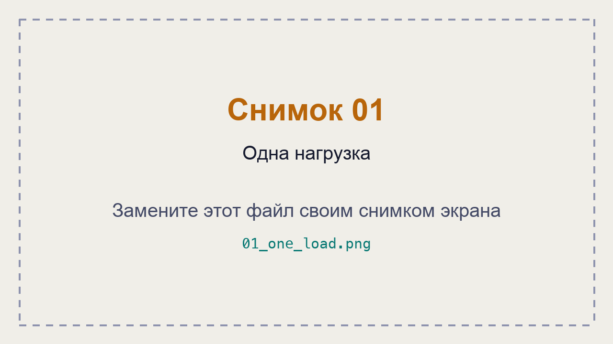
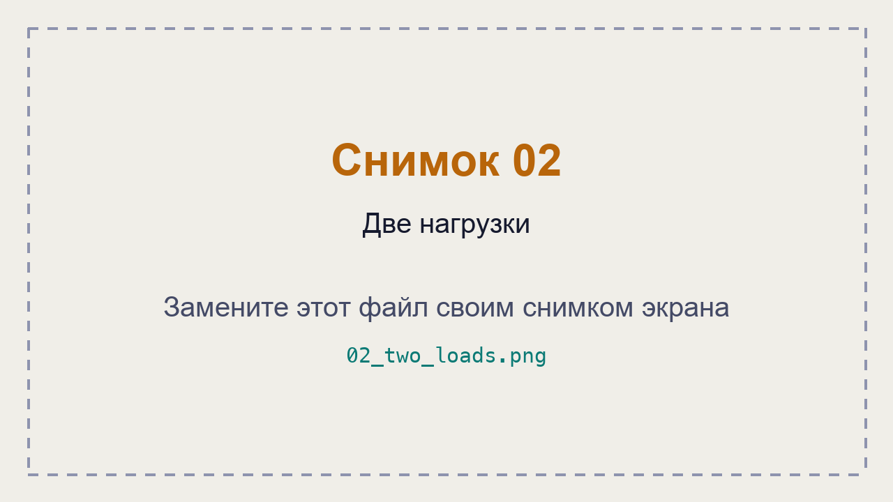
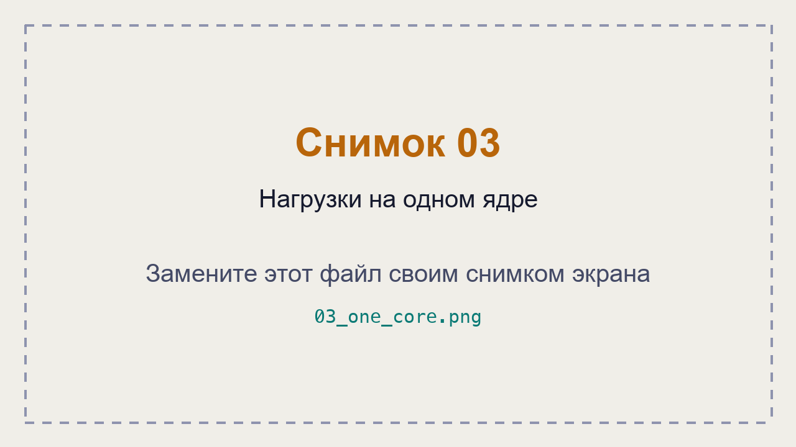
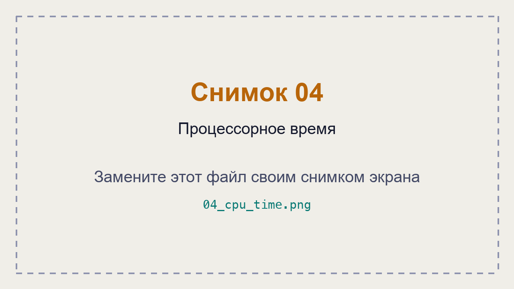

# ЛР 6. Кто загружает процессор

Система: ___
Ядер (логических процессоров): ___

## Одна нагрузка
Процент процесса в мониторе: ___
Общая загрузка: ___
На каких ядрах видна нагрузка: ___

## Две нагрузки
Проценты обеих нагрузок и общая загрузка: ___
На одном ядре (в macOS — фоновый режим): ___

## Процессорное время
Первый замер, второй замер, пауза: ___
Загрузка по замерам: ___
Почему процент в мониторе не говорит о скорости работы: ___

Не получилось: ___

## Снимки экрана

Сохраните снимок поверх заглушки в папке `screenshots/` с тем же именем — ссылки ниже менять не нужно.

### 1. Одна нагрузка
Шаг 1. Видно: процесс Python в мониторе: его процент и общая загрузка.

### 2. Две нагрузки
Шаг 3. Видно: два процесса Python и загрузка ядер.

### 3. Нагрузки на одном ядре
Шаг 4. Видно: две нагрузки на одном ядре и их проценты; в macOS — два числа оборотов цикла.

### 4. Процессорное время
Шаг 5. Видно: два замера процессорного времени с паузой между ними.

