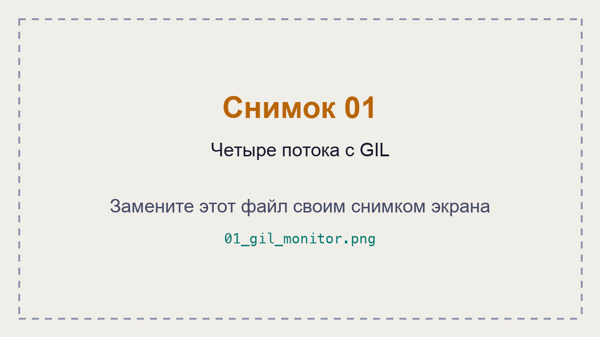
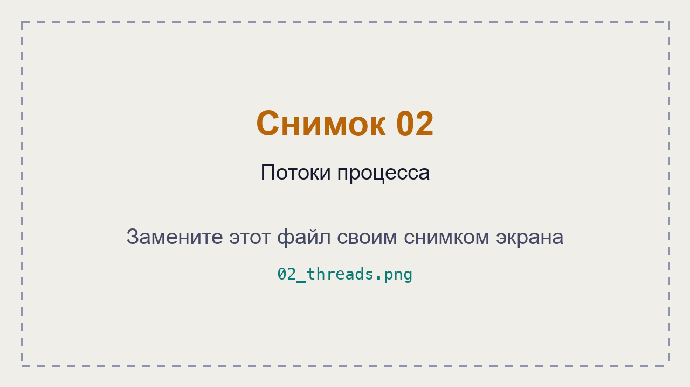
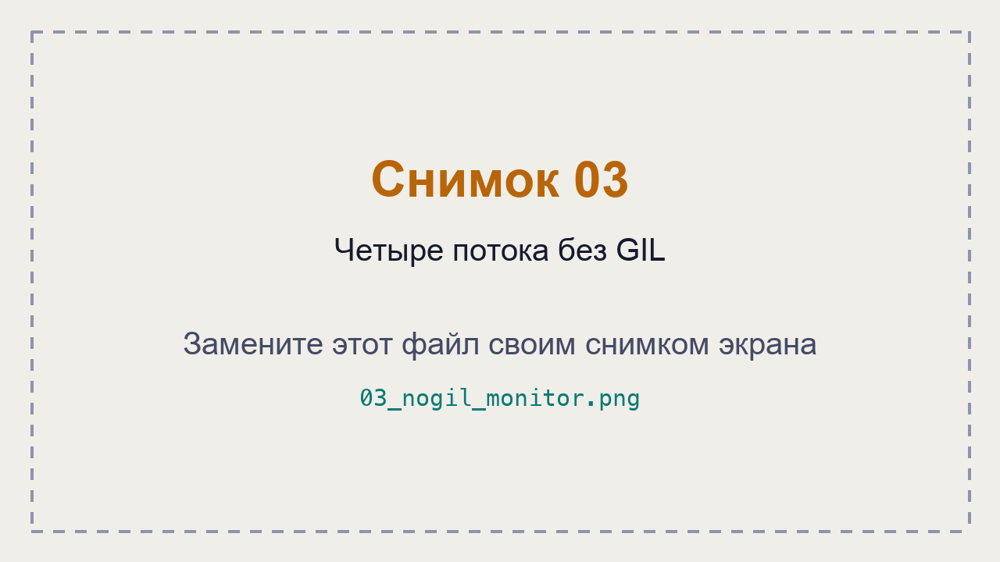
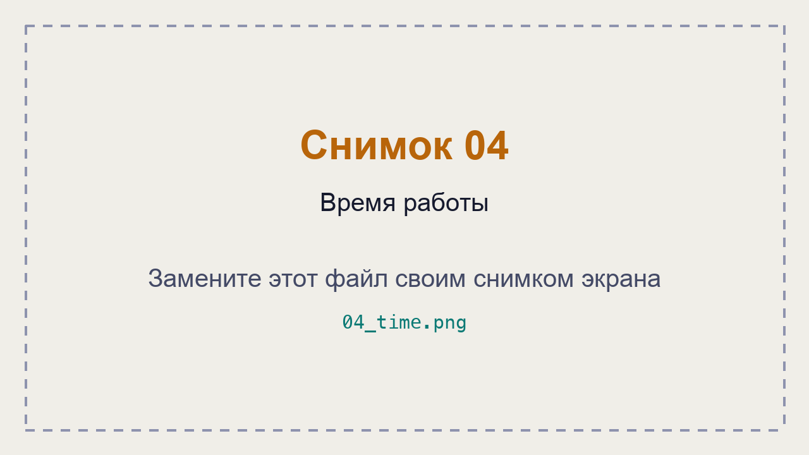

# ЛР 7. Потоки Python и GIL

Система: ___
Ядер (логических процессоров): ___
Версии Python (обычный и без GIL): ___

## Python с GIL
Процент процесса и число потоков: ___
Сколько потоков выполняется одновременно: ___

## Python без GIL
Процент процесса и проценты потоков: ___

## Время работы
С GIL, 1 / 2 / 4 потока: ___
Без GIL, 1 / 2 / 4 потока: ___
Без GIL с PYTHON_GIL=1: ___
Ожидание, 1 и 4 потока: ___
Почему ожидающие потоки ускоряются и с GIL: ___

Не получилось: ___

## Снимки экрана

Сохраните снимок поверх заглушки в папке `screenshots/` с тем же именем — ссылки ниже менять не нужно.

### 1. Четыре потока с GIL
Шаг 1. Видно: процесс Python в мониторе: его процент и число потоков.

### 2. Потоки процесса
Шаг 2. Видно: список потоков процесса: сколько выполняется, сколько ждёт.

### 3. Четыре потока без GIL
Шаг 3. Видно: процесс python3.14t в мониторе: его процент.

### 4. Время работы
Шаг 4. Видно: вывод threads.py в Python с GIL и без.

