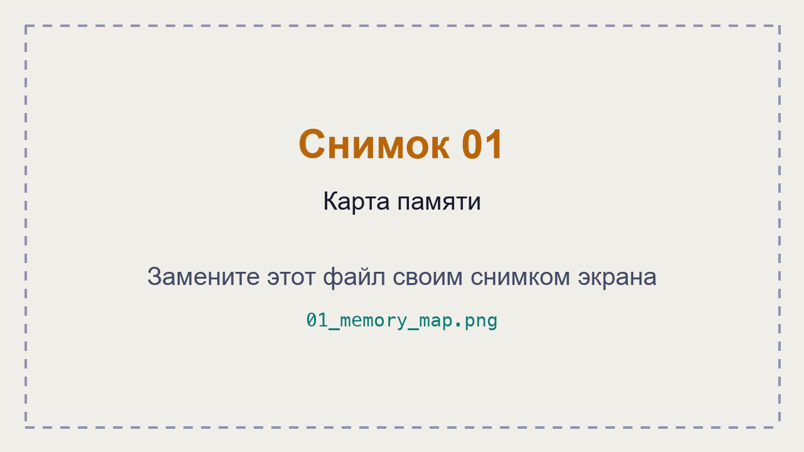
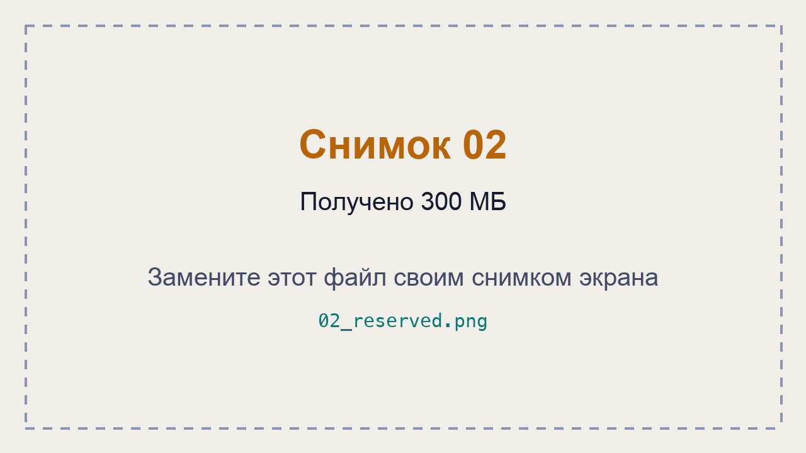
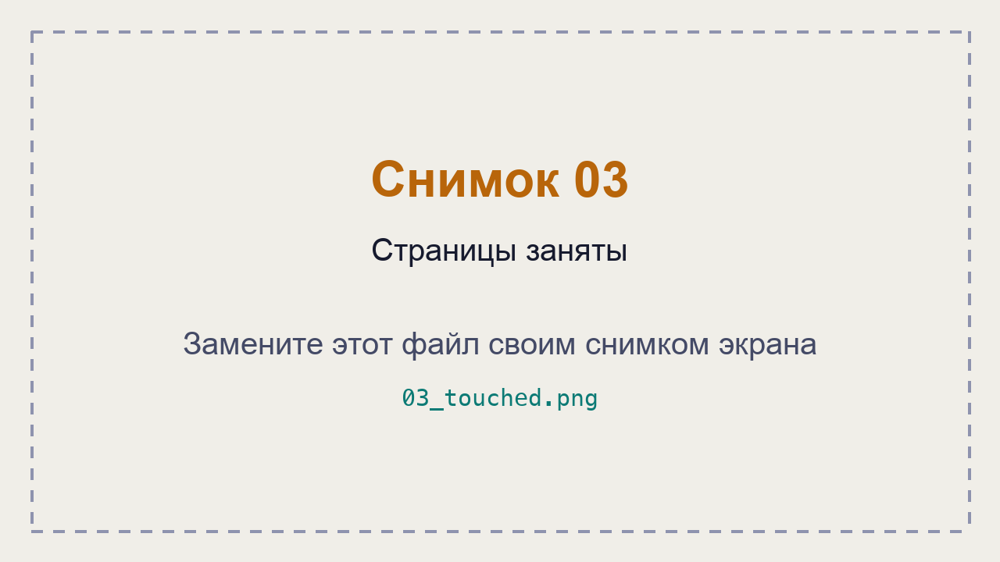
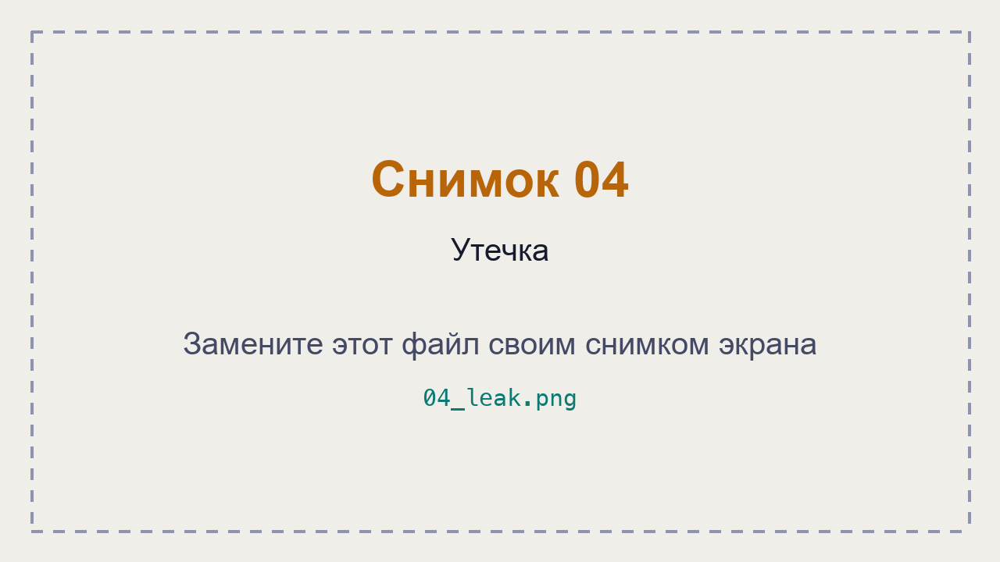

# ЛР 8. Карта памяти

Система: ___
Чем мерил (виртуальная и занятая): ___

## Этапы mem.py
Старт: ___
Получил 300 МБ: ___
Записал в каждую страницу: ___
Освободил: ___
Почему занятая память выросла только на третьем этапе: ___

## Карта памяти
Из каких частей состоит память процесса: ___

## Утечка
Пять замеров leak.py: ___
На сколько росла память за 2 секунды: ___

Не получилось: ___

## Снимки экрана

Сохраните снимок поверх заглушки в папке `screenshots/` с тем же именем — ссылки ниже менять не нужно.

### 1. Карта памяти
Шаг 2. Видно: карта памяти процесса mem.py на старте и её итог.

### 2. Получено 300 МБ
Шаг 3. Видно: виртуальная память выросла на 300 МБ, занятая — нет.

### 3. Страницы заняты
Шаг 4. Видно: занятая память (в macOS — физический след) после записи в каждую страницу.

### 4. Утечка
Шаг 6. Видно: пять замеров памяти leak.py.

