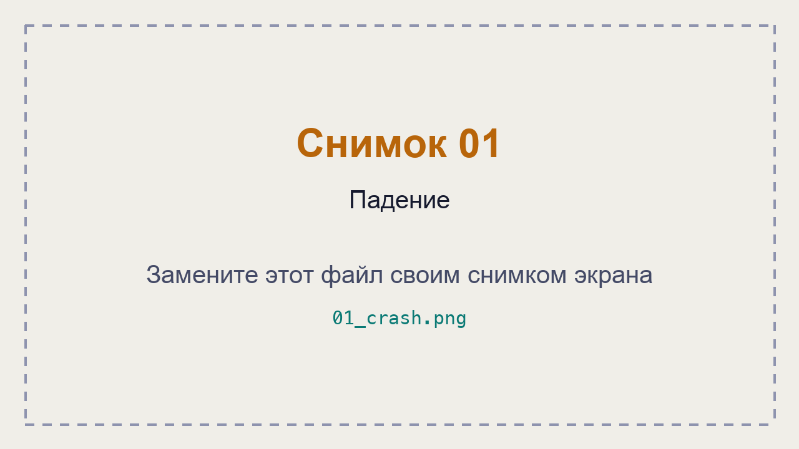
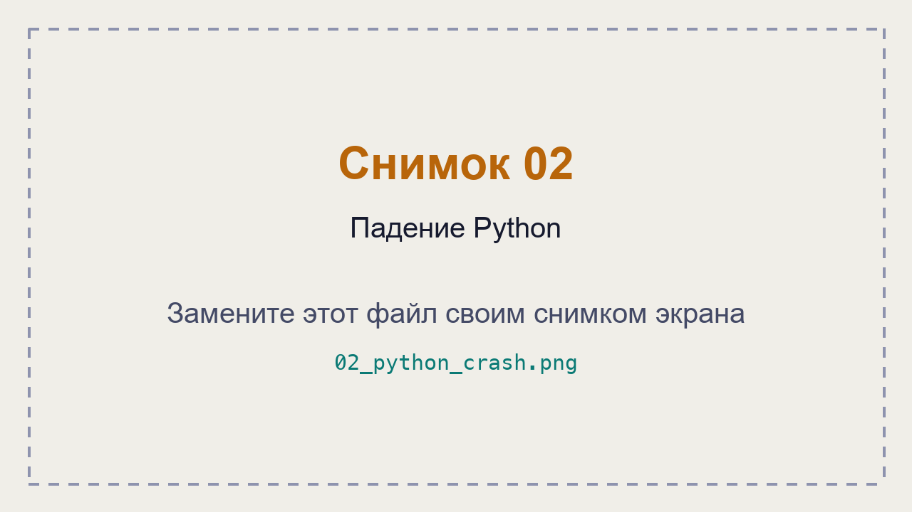
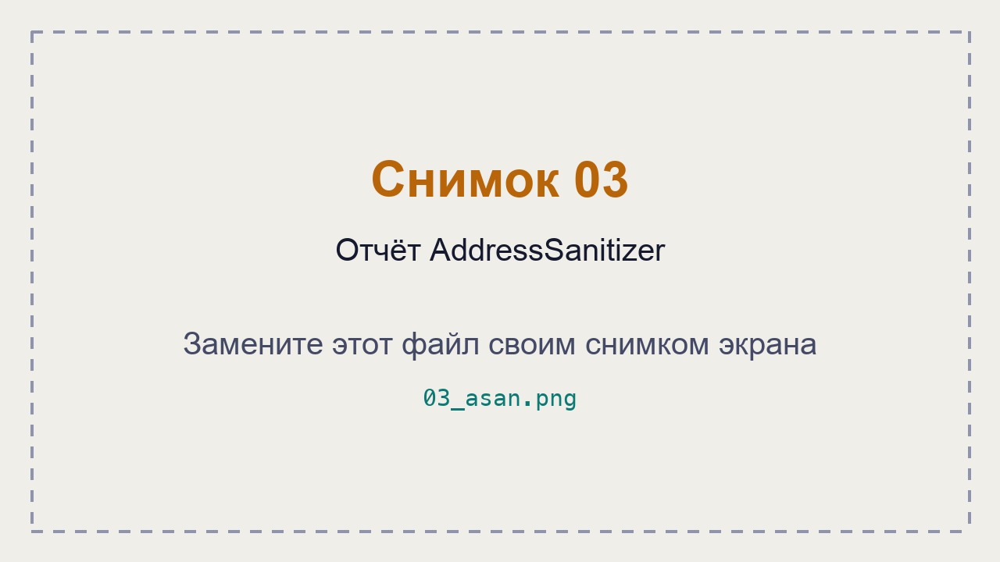
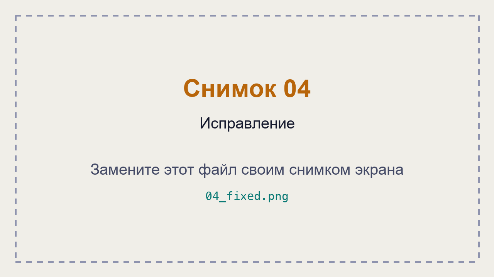

# ЛР 9. Разбор падения

Система: ___
Компилятор: ___

## Падение
crash null: что напечатано и код завершения: ___
ctypes_crash.py: что напечатал Python: ___
Где система записала падение: ___

## Молчаливые ошибки
crash overflow: limit до и после, код: ___
crash heap без проверки: ___
AddressSanitizer для heap: вид ошибки и строка: ___
AddressSanitizer для uaf: вид ошибки и две строки: ___

## Исправление
Что изменено и что напечатала исправленная программа: ___

Не получилось: ___

## Снимки экрана

Сохраните снимок поверх заглушки в папке `screenshots/` с тем же именем — ссылки ниже менять не нужно.

### 1. Падение
Шаг 1. Видно: запуск crash null и код завершения.

### 2. Падение Python
Шаг 2. Видно: вывод ctypes_crash.py и запись системы о падении.

### 3. Отчёт AddressSanitizer
Шаг 4. Видно: вывод crash heap без проверки и с AddressSanitizer (на Windows с ARM — без проверки).

### 4. Исправление
Шаг 6. Видно: разница файлов и вывод исправленной программы.

